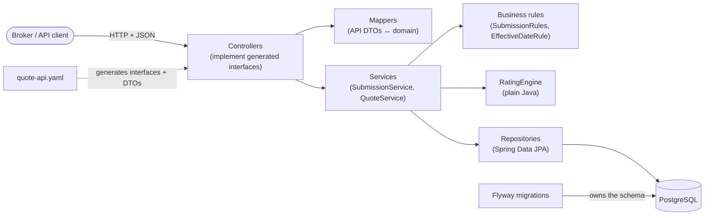

# Quote Service

A reference implementation of a small-business general liability (GL) submission-to-quote API,
built contract-first. A broker submits a risk; the service validates it, rates it against
effective-dated reference data, and returns a quote that is priced, referred or declined. The
OpenAPI document is the source of truth, every decision a quote depends on is stored with it, and
the build enforces the test and design rules described below. Java 21, Spring Boot 4,
PostgreSQL, Flyway.

## Why this exists

I'm an engineering leader rebuilding hands-on skills. This is the kind of paved-road template I'd
want teams to start from: a small, real domain with the design decisions written down and
enforced by the build, not just described.

## Architecture



Errors from any layer are rendered by one `ProblemHandler` as RFC 9457 Problem Details.

## Key design decisions

- **Contract-first.** Controllers implement interfaces generated from
  [`quote-api.yaml`](src/main/resources/openapi/quote-api.yaml), with default methods disabled,
  so a missing operation on an implemented interface fails compilation instead of returning 501;
  `ContractCoverageIT` catches operations under interfaces nobody implements.
- **Anchored patterns.** Every regex in the contract is anchored (`^…$`), so it validates the
  whole value; JSON Schema patterns are unanchored by default.
- **Flyway owns the schema; Hibernate only validates it** (`ddl-auto=validate`). Merged
  migrations are never edited.
- **API model separate from entities.** Generated DTOs never reach the services; mappers are the
  only classes that know both.
- **400 versus 422.** Schema errors are `400 validation-error`; valid requests that break a
  business rule are `422 business-rule-violation`. All violations are returned together, as
  Problem Details with JSON Pointers.
- **Appetite and rates are reference data**, not code: NAICS appetite, base rates, limit factors
  and state minimum premiums live in tables.
- **One home for every business rule.** Each rule is implemented once, for example appetite in
  `NaicsClass`, the past-date rule in `EffectiveDateRule` (used at submission and at quote time),
  pricing in `RatingEngine` and quote validity in `QuoteValidity`.
- **Framework-free rating engine.** No Spring, JPA or database code; an ArchUnit test enforces
  it.
- **QUOTED, REFERRED and DECLINED are business results**, returned as `201`, not errors.
- **Effective-dated, append-only rates with load timestamps.** Rate changes and corrections are
  new rows; a database trigger blocks updates and deletes, so history is never rewritten. Rates
  are selected by the policy effective date, not the quote date.
- **Every quote stores the rate rows it consulted**, whatever its outcome, plus its rating inputs,
  so any quote can be explained later from stored data.
- **Rounding in one named place.** `RatingEngine.PREMIUM_ROUNDING` (half-up to cents, once, at
  the end); everywhere else uses `RoundingMode.UNNECESSARY`, which fails rather than rounds.
- **Expiry derived at read time** from `expiresAt` and an injected `Clock`; `EXPIRED` is never
  stored.
- **`Cache-Control: no-store` on quote responses**, because a quote's status can change with time
  alone.

## Fictional rating

> **The rating formula, rates and NAICS appetite are fictional and simplified. They are not
> actuarially derived and must not be used for real underwriting.**

```
premium = max(annual revenue ÷ 1,000 × class base rate × limit factor, state minimum premium)
```

rounded half-up to cents, once, at the end.

| Class (NAICS) | Base rate per $1,000 | Automatic-quoting ceiling |
|---|---|---|
| 722511 Full-Service Restaurants | 2.1000 | 5,000,000 |
| 722513 Limited-Service Restaurants | 1.8000 | 5,000,000 |
| 238220 Plumbing, Heating, and Air-Conditioning Contractors | 4.5000 | 3,000,000 |
| 541511 Custom Computer Programming Services | 0.6000 | 10,000,000 |
| 812111 Barber Shops | 1.4000 | 1,000,000 |

213111 (Drilling Oil and Gas Wells) is outside appetite. Limit factors: 1,000,000 / 2,000,000 →
1.0000; 2,000,000 / 4,000,000 → 1.3500. State minimum premiums: 500.00, except CA 650.00, FL
600.00 and NY 750.00; they vary by state because rates are filed with each state's regulator.
The rating state is the risk address's state.

Outcomes, in order of precedence:

1. **DECLINED** `CLASS_NOT_WRITTEN`: the class has left appetite since the submission was made.
2. **REFERRED**, with every reason that applies: `NO_RATE_FOR_CLASS`, `LIMIT_NOT_RATED` or
   `NO_MINIMUM_FOR_STATE` (no row in effect), or `REVENUE_ABOVE_AUTO_LIMIT`.
3. **QUOTED** otherwise, with the factors applied (`CLASS`, then `LIMIT`).

In production, rounding rules (mode, precision, and whether any intermediate rounding applies)
come from the filed rating manual. The contract's examples (`TERRITORY` and `REVENUE_BAND`
factors, a premium of 2847.50) illustrate the open set of factor codes; this implementation
doesn't produce them.

How rates are selected, how to change or correct them, and how to explain any stored quote:
[docs/rating-data.md](docs/rating-data.md).

## API overview

Full contract: [`src/main/resources/openapi/quote-api.yaml`](src/main/resources/openapi/quote-api.yaml).

| Method and path | Purpose | Main responses |
|---|---|---|
| `POST /v1/submissions` | Submit a risk | `201`, `400`, `415`, `422` |
| `GET /v1/submissions/{submissionId}` | Read a submission | `200`, `404` |
| `POST /v1/submissions/{submissionId}/quotes` | Rate it and create a quote | `201` (`QUOTED`, `REFERRED` or `DECLINED`), `404`, `422` |
| `GET /v1/quotes/{quoteId}` | Read a quote | `200`, `404` |

- Errors are `application/problem+json` with a stable `type`, a `traceId`, and `errors[]`
  pointers for `400` and `422`.
- A quote is valid for exactly 30 × 24 hours from `createdAt` (`expiresAt`, UTC), not "through
  the end of the 30th day". From that instant, `GET` returns it as `EXPIRED`, with the premium
  kept for the record. Show `expiresAt` in the viewer's local time, including the time of day.
- Quote responses carry `Cache-Control: no-store`: rely on `status` and `expiresAt` from a fresh
  response, never a cached copy.
- The contract declares bearer authentication, rate limiting and idempotency keys; these aren't
  implemented yet (see [Deferred](#deferred)).

## Running locally

Prerequisites: Java 21 and Docker. Maven comes with the wrapper (`./mvnw`).

1. Start Postgres:

   ```bash
   docker run -d --name quote-db -e POSTGRES_PASSWORD=devpass -e POSTGRES_DB=quotes -p 5432:5432 postgres:17
   ```

2. Start the service; Flyway applies the migrations on startup:

   ```bash
   ./mvnw spring-boot:run
   ```

   The datasource defaults match the container above. Set `DB_URL`, `DB_USERNAME` and
   `DB_PASSWORD` to use another database; the defaults are for local development only.

3. Try it. Each command is a single line; run them in order in the same terminal (needs `jq`):

   ```bash
   BASE=http://localhost:8080; EFFECTIVE=$(date -v+7d +%F 2>/dev/null || date -d '+7 days' +%F); SUBMISSION_ID=$(curl -s -X POST "$BASE/v1/submissions" -H 'Content-Type: application/json' -d '{"businessName":"Lone Star Smokehouse LLC","address":{"line1":"1200 Congress Ave","city":"Austin","region":"TX","postalCode":"78701","country":"US"},"classOfBusiness":{"naicsCode":"722511"},"annualRevenue":{"amount":"1200000.00","currency":"USD"},"requestedLimit":{"perOccurrence":{"amount":"1000000.00","currency":"USD"},"aggregate":{"amount":"2000000.00","currency":"USD"}},"effectiveDate":"'"$EFFECTIVE"'"}' | jq -r .id); echo "SUBMISSION_ID=$SUBMISSION_ID"
   ```

   ```bash
   QUOTE_ID=$(curl -s -X POST "$BASE/v1/submissions/$SUBMISSION_ID/quotes" | tee /dev/tty | jq -r .id); echo; echo "QUOTE_ID=$QUOTE_ID"
   ```

   ```bash
   curl -s -i "$BASE/v1/quotes/$QUOTE_ID"; echo
   ```

   ```bash
   curl -s -i -X POST "$BASE/v1/submissions/sub_DOESNOTEXIST/quotes"; echo
   ```

   Expect a `QUOTED` quote at 2520.00 USD, the same quote with `Cache-Control: no-store`, and a
   `404` Problem Details response for the unknown submission.

## Testing

All tests live in `src/test/java`; the class name sets the layer, and the build enforces it:
Surefire runs `*Test` during `test`, and Failsafe runs `*IT` during `integration-test`/`verify`.

| Layer | Convention | What it's for | Docker |
|---|---|---|---|
| Unit | `*Test`; JUnit 5, AssertJ, Mockito; no Spring context | Business logic and edge cases, exhaustively and fast (`RatingEngineTest`, `SubmissionRulesTest`) | No |
| Slice | `*Test` + `@Tag("slice")` + `@WebMvcTest` | The web layer with services mocked: status codes, headers, Problem Details, validation (`ApiWebLayerTest`) | No |
| Integration | `*IT`; full context + Testcontainers Postgres | Real wiring against a throwaway database: SQL, migrations, transactions, end to end (`QuoteApiIT`) | Yes |

- Slice and integration tests also check every response against `quote-api.yaml`
  (`OpenApiContract`).
- `RatingArchitectureTest` (ArchUnit) fails the build if the `rating` package, or its tests,
  depend on Spring, JPA, the database, or the JPA-backed application packages.
- Integration tests never touch your local database: Testcontainers starts a fresh
  `postgres:17-alpine` container on a random port.

| Command | Runs | Docker | Coverage |
|---|---|---|---|
| `./mvnw test` | Unit + slice | No | Unit report, no gate |
| `./mvnw test -DexcludedGroups=slice` | Unit only | No | — |
| `./mvnw test -Dgroups=slice` | Slice only | No | — |
| `./mvnw test -Dtest=RatingEngineTest` | One test class | No | — |
| `./mvnw verify` | Everything: Surefire, then Failsafe | Yes | Both reports and both gates |
| `./mvnw verify -Dtest=NONE -Dsurefire.failIfNoSpecifiedTests=false -Dit.test=QuoteApiIT` | One integration test class | Yes | Partial: the gates aren't meaningful |

**Coverage gates (JaCoCo).** `./mvnw verify` fails the build unless the `rating` package has
≥ 90% line coverage from unit tests alone and the code base has ≥ 80% line coverage on unit and
integration data combined. Reports: `target/site/jacoco-unit/` and
`target/site/jacoco-combined/`, written before the checks so a failed build still leaves both.
Generated code (`com.kowalchuk.quoteservice.api`) is excluded. The gates are bypassed by
`-DskipTests`, `-Djacoco.skip=true` and `-DskipITs`, so CI should use none of them. The JaCoCo
agent uses the `argLine` property: to add test JVM options, write `<argLine>@{argLine} …</argLine>`.

**IDE note.** VS Code's Java extension (and Eclipse) build into `target-ide/`, via the `ide`
profile in `pom.xml`, so they never collide with Maven's `target/`. After pulling this change,
run "Java: Clean Java Language Server Workspace" once.

## Roadmap

Planned; none of this has started.

- Deployment to Azure Container Apps with GitHub Actions.
- An Angular front end for brokers.
- Cosmos DB for raw submissions as received.
- AI-assisted extraction of submission data from documents.

## Deferred

Known gaps and decisions left open, recorded rather than hidden:

- **Idempotency enforcement.** The `Idempotency-Key` header is validated but not honoured; a
  retry creates a duplicate (TODOs in both controllers, and a test records today's behaviour).
- **Authentication and broker scoping.** The contract declares bearer tokens, and that a broker
  gets `404` for another broker's resources; neither is implemented.
- **Rate limiting (`429`) and `503` handling**, declared in the contract.
- **Tracing.** `TraceIdFilter` is a stand-in until Micrometer Tracing.
- **Blank business names.** A name made only of non-breaking spaces is accepted (Java's `\s` is
  ASCII-only, unlike the contract's ECMAScript regex); a test records this gap.
- **New business versus renewal rating.**
- **Rate changes loaded by business users instead of migrations.** Loading while the service runs
  breaks the assumption that no rate load overlaps a quote, so loads would need to be published
  atomically to keep the stored evidence exact.
- **Multi-location / multi-state risks.** This needs a contract change (a list of locations, each
  with its share of revenue; likely `/v2`), rating per location, and per-location audit rows.
  **Open question for underwriting/compliance:** how minimum premiums apply across states.
- **Withdrawing a rate or limit pair** (needs an end date or a "withdrawn" row).
- **Per-class exposure bases** (payroll, square footage) with `exposure_base` / `rate_unit`
  columns.
- **Other per-state values** (state factors, taxes and fees).
- **Validating `address.region`** against real state codes at submission time.
- **Downstream rounding and reconciliation** (once binding, installments or ledger feeds exist):
  the policy system is the system of record for premium; every split uses an allocation rule
  that preserves the total; each interface states its rounding mode, precision and step; and
  reconciliation uses tolerances and a rounding variance account.
- **Business time zone** (one decision covering two rules): whether quotes should be valid
  through the end of the 30th calendar day, and whether "today" should be local rather than UTC,
  and in which zone.
- **Expiry capped at the policy effective date.**
- **Quote validity period varying by state or product**: it would become effective-dated
  reference data, selected by the quote creation date.
- **Quote validity in SQL** (with the first feature that lists or binds quotes): any query must
  be added to `QuoteValidity`, take `now` from the injected clock, and be tested against the
  Java predicate; binding must re-check atomically.

## Built with AI

Developed with Claude Code, with every change reviewed by me in plan and manual modes. My first
test (`RatingEngineTest.quotesStandardRiskAtExpectedPremium_handWritten`) was written by hand.
