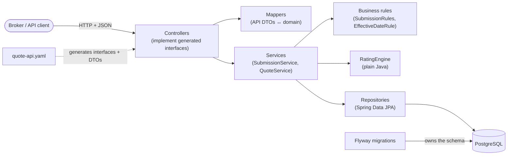

# Quote Service

A reference implementation of a small-business general liability (GL) submission-to-quote API,
built contract-first. A broker submits a risk; the service validates it, rates it against
effective-dated reference data, and returns a quote that is priced, referred or declined. The
OpenAPI document is the source of truth, every decision a quote depends on is stored with it, and
the build enforces the test and design rules described below. Java 21, Spring Boot 4,
PostgreSQL, Flyway.

## Why this exists

I'm an engineering leader rebuilding hands-on skills. This is the kind of paved-road template I'd
want teams to start from: a small, real domain with the design decisions written down and
enforced by the build, not just described.

## Architecture



Errors from any layer are rendered by one `ProblemHandler` as RFC 9457 Problem Details.

## Key design decisions

- **Contract-first.** Controllers implement interfaces generated from
  [`quote-api.yaml`](src/main/resources/openapi/quote-api.yaml), with default methods disabled,
  so a missing operation on an implemented interface fails compilation instead of returning 501;
  `ContractCoverageIT` catches operations under interfaces nobody implements.
- **Anchored patterns.** Every regex in the contract is anchored (`^…$`), so it validates the
  whole value; JSON Schema patterns are unanchored by default.
- **Flyway owns the schema; Hibernate only validates it** (`ddl-auto=validate`). Merged
  migrations are never edited.
- **API model separate from entities.** Generated DTOs never reach the services; mappers are the
  only classes that know both.
- **400 versus 422.** Schema errors are `400 validation-error`; valid requests that break a
  business rule are `422 business-rule-violation`. All violations are returned together, as
  Problem Details with JSON Pointers.
- **Appetite and rates are reference data**, not code: NAICS appetite, base rates, limit factors
  and state minimum premiums live in tables.
- **One home for every business rule.** Each rule is implemented once, for example appetite in
  `NaicsClass`, the past-date rule in `EffectiveDateRule` (used at submission and at quote time),
  pricing in `RatingEngine` and quote validity in `QuoteValidity`.
- **Framework-free rating engine.** No Spring, JPA or database code; an ArchUnit test enforces
  it.
- **QUOTED, REFERRED and DECLINED are business results**, returned as `201`, not errors.
- **Effective-dated, append-only rates with load timestamps.** Rate changes and corrections are
  new rows; a database trigger blocks updates and deletes, so history is never rewritten. Rates
  are selected by the policy effective date, not the quote date.
- **Every quote stores the rate rows it consulted**, whatever its outcome, plus its rating inputs,
  so any quote can be explained later from stored data.
- **Rounding in one named place.** `RatingEngine.PREMIUM_ROUNDING` (half-up to cents, once, at
  the end); everywhere else uses `RoundingMode.UNNECESSARY`, which fails rather than rounds.
- **Expiry derived at read time** from `expiresAt` and an injected `Clock`; `EXPIRED` is never
  stored.
- **`Cache-Control: no-store` on quote responses**, because a quote's status can change with time
  alone.

## Fictional rating

> **The rating formula, rates and NAICS appetite are fictional and simplified. They are not
> actuarially derived and must not be used for real underwriting.**

```
premium = max(annual revenue ÷ 1,000 × class base rate × limit factor, state minimum premium)
```

rounded half-up to cents, once, at the end.

| Class (NAICS) | Base rate per $1,000 | Automatic-quoting ceiling |
|---|---|---|
| 722511 Full-Service Restaurants | 2.1000 | 5,000,000 |
| 722513 Limited-Service Restaurants | 1.8000 | 5,000,000 |
| 238220 Plumbing, Heating, and Air-Conditioning Contractors | 4.5000 | 3,000,000 |
| 541511 Custom Computer Programming Services | 0.6000 | 10,000,000 |
| 812111 Barber Shops | 1.4000 | 1,000,000 |

213111 (Drilling Oil and Gas Wells) is outside appetite. Limit factors: 1,000,000 / 2,000,000 →
1.0000; 2,000,000 / 4,000,000 → 1.3500. State minimum premiums: 500.00, except CA 650.00, FL
600.00 and NY 750.00; they vary by state because rates are filed with each state's regulator.
The rating state is the risk address's state.

Outcomes, in order of precedence:

1. **DECLINED** `CLASS_NOT_WRITTEN`: the class has left appetite since the submission was made.
2. **REFERRED**, with every reason that applies: `NO_RATE_FOR_CLASS`, `LIMIT_NOT_RATED` or
   `NO_MINIMUM_FOR_STATE` (no row in effect), or `REVENUE_ABOVE_AUTO_LIMIT`.
3. **QUOTED** otherwise, with the factors applied (`CLASS`, then `LIMIT`).

In production, rounding rules (mode, precision, and whether any intermediate rounding applies)
come from the filed rating manual. The contract's examples (`TERRITORY` and `REVENUE_BAND`
factors, a premium of 2847.50) illustrate the open set of factor codes; this implementation
doesn't produce them.

How rates are selected, how to change or correct them, and how to explain any stored quote:
[docs/rating-data.md](docs/rating-data.md).

## API overview

Full contract: [`src/main/resources/openapi/quote-api.yaml`](src/main/resources/openapi/quote-api.yaml).

| Method and path | Purpose | Main responses |
|---|---|---|
| `POST /v1/submissions` | Submit a risk | `201`, `400`, `415`, `422` |
| `GET /v1/submissions/{submissionId}` | Read a submission | `200`, `404` |
| `POST /v1/submissions/{submissionId}/quotes` | Rate it and create a quote | `201` (`QUOTED`, `REFERRED` or `DECLINED`), `404`, `422` |
| `GET /v1/quotes/{quoteId}` | Read a quote | `200`, `404` |
| `POST /v1/extractions` | Upload a broker PDF; get an AI-drafted submission to review | `201`, `413`, `422`, `502`, `503` |
| `GET /v1/extractions/{extractionId}` | Read a draft and its review state | `200`, `404` |
| `POST /v1/extractions/{extractionId}/confirm` | Confirm the reviewed submission | `201` (a submission), `409`, `422` |

- Errors are `application/problem+json` with a stable `type`, a `traceId`, and `errors[]`
  pointers for `400` and `422`.
- A quote is valid for exactly 30 × 24 hours from `createdAt` (`expiresAt`, UTC), not "through
  the end of the 30th day". From that instant, `GET` returns it as `EXPIRED`, with the premium
  kept for the record. Show `expiresAt` in the viewer's local time, including the time of day.
- Quote responses carry `Cache-Control: no-store`: rely on `status` and `expiresAt` from a fresh
  response, never a cached copy.
- The contract declares bearer authentication, rate limiting and idempotency keys; the API
  doesn't implement these yet (see [Deferred](#deferred)). The deployed app sits behind Entra ID
  sign-in (see [Authentication](#authentication)).

## Running locally

Prerequisites: Java 21 and Docker. Maven comes with the wrapper (`./mvnw`).

1. Start Postgres:

   ```bash
   docker run -d --name quote-db -e POSTGRES_PASSWORD=devpass -e POSTGRES_DB=quotes -p 5432:5432 postgres:17
   ```

2. Start the service; Flyway applies the migrations on startup:

   ```bash
   ./mvnw spring-boot:run
   ```

   The datasource defaults match the container above. Set `DB_URL`, `DB_USERNAME` and
   `DB_PASSWORD` to use another database; the defaults are for local development only.

3. Try it. Each command is a single line; run them in order in the same terminal (needs `jq`):

   ```bash
   BASE=http://localhost:8080; EFFECTIVE=$(date -v+7d +%F 2>/dev/null || date -d '+7 days' +%F); SUBMISSION_ID=$(curl -s -X POST "$BASE/v1/submissions" -H 'Content-Type: application/json' -d '{"businessName":"Lone Star Smokehouse LLC","address":{"line1":"1200 Congress Ave","city":"Austin","region":"TX","postalCode":"78701","country":"US"},"classOfBusiness":{"naicsCode":"722511"},"annualRevenue":{"amount":"1200000.00","currency":"USD"},"requestedLimit":{"perOccurrence":{"amount":"1000000.00","currency":"USD"},"aggregate":{"amount":"2000000.00","currency":"USD"}},"effectiveDate":"'"$EFFECTIVE"'"}' | jq -r .id); echo "SUBMISSION_ID=$SUBMISSION_ID"
   ```

   ```bash
   QUOTE_ID=$(curl -s -X POST "$BASE/v1/submissions/$SUBMISSION_ID/quotes" | tee /dev/tty | jq -r .id); echo; echo "QUOTE_ID=$QUOTE_ID"
   ```

   ```bash
   curl -s -i "$BASE/v1/quotes/$QUOTE_ID"; echo
   ```

   ```bash
   curl -s -i -X POST "$BASE/v1/submissions/sub_DOESNOTEXIST/quotes"; echo
   ```

   Expect a `QUOTED` quote at 2520.00 USD, the same quote with `Cache-Control: no-store`, and a
   `404` Problem Details response for the unknown submission.

### Front end

An Angular app in `frontend/` for the document-to-quote workflow:

1. `/`: upload a broker PDF, which is drafted into an extraction.
2. `/extractions/<id>`: review the draft with its flags and evidence, then confirm it as a
   submission. A confirmed extraction shows the submission read-only.
3. `/submissions/<id>`: the submission, and **Get quote**, which shows the premium, rating
   factors and expiry, or the referral or decline reasons.

Its API client is generated from `quote-api.yaml` (openapi-generator 7.26.0, as in Maven) before
every start, build, test and lint, and is never committed. Needs Node 24 and Java 21 (for the
generator); with the service running on port 8080:

```bash
cd frontend && npm ci && npm start
```

`ng serve` proxies `/v1` to `localhost:8080`. Open `http://localhost:4200/`. `npm run lint`,
`npm test` and `npm run build` are the checks; CI runs all three before the Maven build.

**In production** there is no separate web server. The Docker build compiles the app in a
`frontend` stage (Node 24 with Temurin's Java 21 copied in for the generator, on the build
machine's platform) and copies it into the jar's static resources. So one origin serves the UI
and `/v1`, with no CORS:

- **Deep links:** `SpaForwardController` forwards `/extractions/<id>` and `/submissions/<id>` to
  `index.html`, so a reload works. When you add an Angular route, add its path there too. Any
  other unknown path, including under `/v1` and `/actuator`, still gets the 404 Problem Details.
- **Caching:** `index.html` is served `no-store`, so a deploy shows up on the next load. The
  hashed JS and CSS bundles are cached for a year as `immutable` (`StaticResourceConfig`).
- **Local runs:** `./mvnw spring-boot:run` serves only the API; the UI is packaged by the Docker
  build alone.

### Authentication

Azure Container Apps' built-in authentication, with Microsoft Entra ID (single tenant), sits in
front of the whole deployed app, UI and `/v1` alike. It's configured in Azure rather than in code,
so the app itself never sees tokens:

- **Who gets what:** browsers without a session are sent to Entra sign-in; other clients get `401`.
- **Excluded paths:** `/actuator/health` and its `liveness` and `readiness` paths stay open for the
  health probes and the deploy smoke test. The smoke test also checks that `/` and a `/v1` path
  return `401`.
- **curl:** calls against the Azure URL now need a signed-in browser session.
- **Local runs** (`./mvnw spring-boot:run`, `ng serve`, Docker) are unaffected.

## Testing

The backend's tests live in `src/test/java` (the front end's Vitest specs sit beside its
components, and the browser tests are under [End-to-end tests](#end-to-end-tests)). The class name
sets the layer, and the build enforces it:
Surefire runs `*Test` during `test`, and Failsafe runs `*IT` during `integration-test`/`verify`.

| Layer | Convention | What it's for | Docker |
|---|---|---|---|
| Unit | `*Test`; JUnit 5, AssertJ, Mockito; no Spring context | Business logic and edge cases, exhaustively and fast (`RatingEngineTest`, `SubmissionRulesTest`) | No |
| Slice | `*Test` + `@Tag("slice")` + `@WebMvcTest` | The web layer with services mocked: status codes, headers, Problem Details, validation (`ApiWebLayerTest`) | No |
| Integration | `*IT`; full context + Testcontainers Postgres | Real wiring against a throwaway database: SQL, migrations, transactions, end to end (`QuoteApiIT`) | Yes |

- Slice and integration tests also check every response against `quote-api.yaml`
  (`OpenApiContract`).
- `RatingArchitectureTest` (ArchUnit) fails the build if the `rating` package, or its tests,
  depend on Spring, JPA, the database, or the JPA-backed application packages.
- `ExtractionArchitectureTest` (ArchUnit) keeps the `extraction` core free of Spring and the
  Azure SDK, and keeps all of extraction away from the submission, quote and rating packages.
- Integration tests never touch your local database: Testcontainers starts a fresh
  `postgres:17-alpine` container on a random port.

| Command | Runs | Docker | Coverage |
|---|---|---|---|
| `./mvnw test` | Unit + slice | No | Unit report, no gate |
| `./mvnw test -DexcludedGroups=slice` | Unit only | No | — |
| `./mvnw test -Dgroups=slice` | Slice only | No | — |
| `./mvnw test -Dtest=RatingEngineTest` | One test class | No | — |
| `./mvnw verify` | Everything: Surefire, then Failsafe | Yes | Both reports and both gates |
| `./mvnw verify -Dtest=NONE -Dsurefire.failIfNoSpecifiedTests=false -Dit.test=QuoteApiIT` | One integration test class | Yes | Partial: the gates aren't meaningful |

**Coverage gates (JaCoCo).** `./mvnw verify` fails the build unless the `rating` package has
≥ 90% line coverage from unit tests alone and the code base has ≥ 80% line coverage on unit and
integration data combined. Reports: `target/site/jacoco-unit/` and
`target/site/jacoco-combined/`, written before the checks so a failed build still leaves both.
Generated code (`com.kowalchuk.quoteservice.api`) is excluded. The gates are bypassed by
`-DskipTests`, `-Djacoco.skip=true` and `-DskipITs`, so CI should use none of them. The JaCoCo
agent uses the `argLine` property: to add test JVM options, write `<argLine>@{argLine} …</argLine>`.

**IDE note.** VS Code's Java extension (and Eclipse) build into `target-ide/`, via the `ide`
profile in `pom.xml`, so they never collide with Maven's `target/`. After pulling this change,
run "Java: Clean Java Language Server Workspace" once.

### End-to-end tests

Playwright (`frontend/e2e/`) drives the whole underwriter flow in Chromium against the real
system: the Angular app, the Spring API and a fresh Postgres. Only the AI model is faked, by
`GoldenSetModelClient`, which answers each golden-set document
(`src/test/resources/extraction/golden/`) with its expected extraction and fails on any other.
The tests cover:

- sample-04: the missing revenue is flagged, filled in, confirmed and quoted at $1,170.00;
- sample-02: the suspected-instruction banner is shown;
- reloading a review page by its deep link.

The fake lives in test code and is started by a test main class (`E2eQuoteServiceApplication`)
with the `e2e` profile, so it isn't in the jar or the image and production can't switch it on.

Needs Docker running, Java 21 and Node 24, plus Chromium once
(`npx playwright install chromium`). Then:

```bash
cd frontend && npm run e2e          # add --ui or --headed to watch
npx playwright show-report          # after a failure: traces and screenshots
```

Playwright starts the backend on port 8081 and `ng serve` on 4201, away from the usual 8080 and
4200, whose backend has no fake model. To iterate faster, start the backend once and leave it
running; outside CI, Playwright reuses whatever is already on those ports:

```bash
./mvnw spring-boot:test-run -Dspring-boot.run.main-class=com.kowalchuk.quoteservice.e2e.E2eQuoteServiceApplication \
  -Dspring-boot.run.profiles=e2e -Dspring-boot.run.arguments=--server.port=8081
```

The golden documents' effective dates stop being confirmable in December 2026, so the quote test
moves the date to 30 days ahead, as a reviewer would. CI runs these tests in their own job
alongside the Maven build, and uploads the report and traces when a test fails.

## Roadmap

- **Done:** deployment to Azure Container Apps, with GitHub Actions (OIDC, no stored credentials),
  managed Postgres, Key Vault, health probes and Application Insights.
- **Done: AI-assisted extraction of submission data from broker documents** (see below).
- **Done: an Angular front end for brokers:** upload, review and quote, deployed with the API
  behind sign-in, with Playwright end-to-end tests (see [Front end](#front-end)).
- **Done: an intake archive in Cosmos DB** of submissions and model answers as received (see
  [Intake archive](#intake-archive-cosmos-db)).

### AI document extraction

A broker PDF goes in; a *draft* submission comes out, with every field allowed to be empty, flags
for the reviewer (missing, approximate, ambiguous, invalid, suspected instructions in the
document) and a short source quote per field. The model only drafts: a person confirms the
draft, and it then goes through the normal submission rules.

- `extraction` package, plain Java like `rating`: `DocumentTextReader` (PDFBox; digital PDFs, with
  page and size limits), `ExtractionPrompt` (instructions; the document is wrapped as data),
  `ExtractionResponseParser` (never trusts the model: re-checks every value against the contract's
  formats and flags anything empty), `DocumentExtractor` (the pipeline, with token and latency
  figures).
- `extraction.azure`: the only provider-specific code. Azure OpenAI (gpt-5-mini) with strict
  structured outputs, signed in with Entra ID (managed identity in Azure, `az login` locally).
  There is no API key; key access is disabled on the AI resource.
- The model's output schema (`src/main/resources/extraction/submission-extraction.schema.json`)
  mirrors `SubmissionRequest`; `ExtractionSchemaContractTest` fails if they drift apart.
- A golden set of five fictional documents with expected answers
  (`src/test/resources/extraction/golden/`). `DocumentExtractorTest` runs it with a fake model;
  `GoldenSetLiveEvalTest` scores the real model, field by field, against a 90% pass mark plus two
  rules that must always hold: a missing value is never guessed, and text in a document never
  changes what is extracted.
- `intake` package: the API. `POST /v1/extractions` drafts and stores the draft (not the
  document: only its name, size and SHA-256 are kept). The model call runs outside any database
  transaction. `POST /v1/extractions/{id}/confirm` takes the reviewer's final `SubmissionRequest`,
  creates the submission through `SubmissionService` (same validation and rules) and marks the
  draft confirmed in one transaction, under a row lock so a draft can't be confirmed twice. A
  rule failure creates nothing and leaves the draft to be corrected.

Extraction is switched on only when `QUOTE_EXTRACTION_ENDPOINT` is set, so local runs and the
normal test suite need no Azure resources. To score the model (calls Azure; a few cents):

```bash
az login
EXTRACTION_LIVE_EVAL=true ./mvnw test -Dtest=GoldenSetLiveEvalTest
```

Next: the golden-set evaluation in CI, token and latency metrics in Application Insights, OCR for
scanned documents, and Blob Storage if documents need to be kept.

### Intake archive (Cosmos DB)

Postgres is the system of record. Cosmos DB (NoSQL API) keeps a raw, append-only copy of what came
in, for audit: what a broker actually sent and what the model actually answered, which the
normalised rows in Postgres don't show. Nothing reads it back.

Database `quotes`, container `intake-archive`, partition key `/entityId`. One document per event,
with a deterministic `id` (`<type>-<entityId>`), `entityId`, `type`, `schemaVersion` and
`occurredAt`:

| Event | Entity | Also holds |
|---|---|---|
| `SUBMISSION_RECEIVED` | the submission | `requestJson`: the request body exactly as received; `channel`: `API` (`POST /v1/submissions`) or `EXTRACTION_CONFIRM` (a reviewer's confirm), with its `extractionId` |
| `EXTRACTION_DRAFTED` | the extraction | `modelResponse`: the model's raw JSON answer; `model`, `promptVersion`, `inputTokens`, `outputTokens`, `elapsedMs`; `document`: its SHA-256 and size |

- **Not archived:** the PDF, its text, and the prompt as sent (which contains the text). We don't
  keep broker documents. The model's answer does include its evidence quotes (at most 200
  characters per field, copied from the document); Postgres already holds the same quotes in the
  draft.
- **Raw strings, not parsed JSON:** `requestJson` and `modelResponse` are stored as text, so
  whitespace, key order and number spelling stay exactly as they arrived. The cost is that Cosmos
  can't query inside them.
- **`promptVersion`** is a hash of the instructions and the output schema (`ExtractionPrompt.VERSION`),
  so it changes whenever the prompt does, without anyone remembering to bump it.
- **Append-only:** documents are created, never upserted. A repeat write gets `409` and changes
  nothing.

**Design.** `archive.IntakeArchive` is the port; `archive.cosmos.CosmosIntakeArchive` (the plain
`azure-cosmos` SDK, not Spring Data) is the only adapter and the only code that knows Cosmos
(`ArchiveArchitectureTest`). Without `QUOTE_ARCHIVE_COSMOS_ENDPOINT`, a no-op archive keeps
nothing, so local runs and the test suite need no Azure resources and no emulator. The services
publish events; `ArchiveDispatcher` picks them up **after the transaction commits** (a rejected
confirm archives nothing) and writes them on its own two threads with a bounded queue, so a request
never waits for Cosmos or sees it fail. Failures are logged with the event type and entity ID,
never the payload.

**Sign-in and set-up.** Entra ID only: `DefaultAzureCredential` with the same user-assigned managed
identity as extraction (`AZURE_CLIENT_ID`), or your `az login` locally. Key access is disabled on
the account (`disableLocalAuth`). The app never creates databases or containers; the client
connects lazily, on the first write, so the app starts even if Cosmos is unreachable.

```bash
az cosmosdb sql database create -g rg-quote-service -a cosmos-quote-service-dk -n quotes
az cosmosdb sql container create -g rg-quote-service -a cosmos-quote-service-dk -d quotes \
  -n intake-archive --partition-key-path /entityId
# Cosmos DB Built-in Data Contributor, on this container only, for the app's managed identity
az cosmosdb sql role assignment create -g rg-quote-service -a cosmos-quote-service-dk \
  --role-definition-id 00000000-0000-0000-0000-000000000002 \
  --principal-id <managed identity principal ID> --scope /dbs/quotes/colls/intake-archive
az containerapp update -g rg-quote-service -n ca-quote-service \
  --set-env-vars QUOTE_ARCHIVE_COSMOS_ENDPOINT=https://cosmos-quote-service-dk.documents.azure.com:443/
```

To look at what was archived, open the account's **Data Explorer** in the Azure portal, then
`quotes` > `intake-archive` > **Items**, and filter with, for example,
`SELECT * FROM c WHERE c.entityId = 'sub_…'` (the Azure CLI can't query documents).

**Trade-offs.**

- **Best-effort, so events can be lost:** a crash between the commit and the write, a full queue
  (1,000 events), or Cosmos being down or refusing the write. Failed writes aren't retried. For an
  audit copy beside a system of record, that's the price of never affecting a request.
- **The outbox pattern is the guaranteed-delivery alternative:** write the event to an outbox table
  in the *same* Postgres transaction as the submission, and have a relay copy it to Cosmos and mark
  it sent. Nothing is lost, delivery is at least once, and the deterministic IDs make repeats
  harmless. The costs are a table, a poller (or change data capture), cleanup, and more writes on
  Postgres. Worth it if the archive ever becomes a compliance record rather than a best-effort copy.
- **A second store to run and pay for**, with its own access control and retention (no TTL is set:
  documents are kept until deleted).

## Deferred

Known gaps and decisions left open, recorded rather than hidden:

- **Idempotency enforcement.** The `Idempotency-Key` header is validated but not honoured; a
  retry creates a duplicate (TODOs in both controllers, and a test records today's behaviour).
- **Authentication and broker scoping.** Sign-in now gates the deployed app (see
  [Authentication](#authentication)), but the contract's bearer tokens aren't checked by the API,
  and a broker getting `404` for another broker's resources isn't implemented.
- **Rate limiting (`429`) and `503` handling**, declared in the contract.
- **Tracing.** `TraceIdFilter` is a stand-in until Micrometer Tracing.
- **Blank business names.** A name made only of non-breaking spaces is accepted (Java's `\s` is
  ASCII-only, unlike the contract's ECMAScript regex); a test records this gap.
- **New business versus renewal rating.**
- **Rate changes loaded by business users instead of migrations.** Loading while the service runs
  breaks the assumption that no rate load overlaps a quote, so loads would need to be published
  atomically to keep the stored evidence exact.
- **Multi-location / multi-state risks.** This needs a contract change (a list of locations, each
  with its share of revenue; likely `/v2`), rating per location, and per-location audit rows.
  **Open question for underwriting/compliance:** how minimum premiums apply across states.
- **Withdrawing a rate or limit pair** (needs an end date or a "withdrawn" row).
- **Per-class exposure bases** (payroll, square footage) with `exposure_base` / `rate_unit`
  columns.
- **Other per-state values** (state factors, taxes and fees).
- **Validating `address.region`** against real state codes at submission time.
- **Downstream rounding and reconciliation** (once binding, installments or ledger feeds exist):
  the policy system is the system of record for premium; every split uses an allocation rule
  that preserves the total; each interface states its rounding mode, precision and step; and
  reconciliation uses tolerances and a rounding variance account.
- **Business time zone** (one decision covering two rules): whether quotes should be valid
  through the end of the 30th calendar day, and whether "today" should be local rather than UTC,
  and in which zone.
- **Expiry capped at the policy effective date.**
- **Quote validity period varying by state or product**: it would become effective-dated
  reference data, selected by the quote creation date.
- **Quote validity in SQL** (with the first feature that lists or binds quotes): any query must
  be added to `QuoteValidity`, take `now` from the injected clock, and be tested against the
  Java predicate; binding must re-check atomically.

## Built with AI

Developed with Claude Code (in VS Code, with every change reviewed in plan and manual modes) and
Claude (design, plus the AI extraction phases, delivered as patches that I reviewed, built and
tested before merging). My first test
(`RatingEngineTest.quotesStandardRiskAtExpectedPremium_handWritten`) was written by hand.
